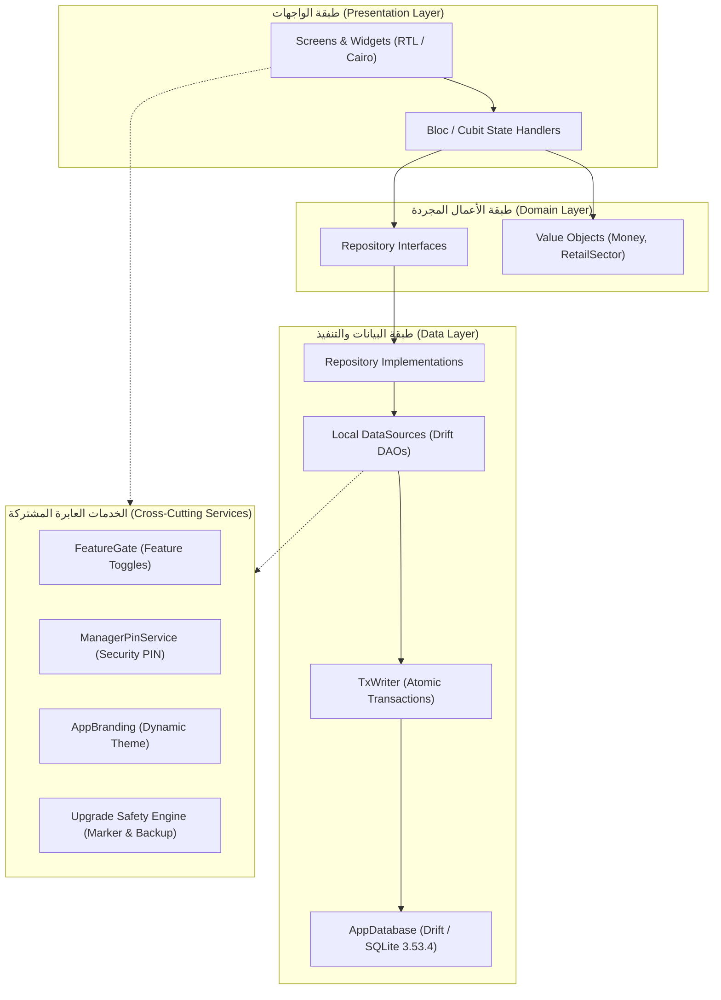

# 02 — المعمارية البرمجية والأنماط المعمارية (Architecture & Patterns)

يعتمد نظام **Bay3ah ERP** على نمط **المعمارية النظيفة (Clean Architecture)** مقترناً بنمط إدارة الحالة **BLoC / Cubit** وحقن التبعيات التلقائي عبر **GetIt + Injectable**، لضمان استقلالية منطق الأعمال التامة عن أطر العمل والواجهات وقواعد البيانات.



---

## 1. الطبقات المعمارية (Architectural Layers)

### أ. طبقة العرض والواجهات (Presentation Layer)
- **الشاشات والمكونات (Screens & Widgets)**: واجهات عربية أصيلة تدعم توجيه النصوص من اليمين لليسار (RTL) مع خط Cairo.
- **إدارة الحالة (Cubit / Bloc)**: تعتمد كل ميزة على Cubit مخصص (مثل `PosCubit`, `ProductFormCubit`, `ShiftCubit`, `InstallmentsCubit`) لفصل دورة حياة الواجهة عن معالجة البيانات، واستقبال حالات واضحة (`Loading`, `Success`, `Failure`).

### ب. طبقة النطاق والأعمال (Domain Layer)
- **الكائنات والكيانات (Entities & Value Objects)**:
  - كائن المبالغ المالية (`Money`): يتعامل مع العملات بالوحدات الصغرى (القروش - Piasters كأعداد صحيحة `int`) لمنع أخطاء التقريب الشائعة في الأعداد العشرية العائمة (`Floating Point Drift`).
  - قطاعات التجزئة (`RetailSector`): يحدد سلوك الحقول وشاشات الإدخال بناءً على نشاط المتجر.
- **عقود المستودعات (Repository Interfaces)**: واجهات مجردة تعيد كائنات `Either<Failure, T>` باستخدام مكتبة `dartz` لضمان المعالجة الوظيفية للأخطاء.

### ج. طبقة البيانات والتخزين (Data Layer)
- **مصادر البيانات المحلية (Local DataSources)**: تتعامل مباشرة مع جداول ومكتبات Drift.
- **منفذ المعاملات الذرية (`TxWriter`)**: يضمن تنفيذ العمليات المركبة (مثل: حفظ الفاتورة + خصم المخزون + تسجيل حركة الخزينة + تسجيل سجل التدقيق) داخل معاملة قاعدة بيانات واحدة لا تتجزأ.
- **قاعدة البيانات (`AppDatabase`)**:
  - مشغلة بواسطة محرك SQLite المدمج عالي الأداء (`3.53.4`).
  - تعمل بنمط `WAL` (`Write-Ahead Logging`) لتحقيق أعلى سرعة قراءة وكتابة متزامنة.

---

## 2. المكونات الهندسية الأساسية (Core Cross-Cutting Components)

### 1. منفذ المعاملات الذرية (`TxWriter`)
يُعد صمام الأمان لمنع أي تلوث أو تجزئة في البيانات. عند تنفيذ أي عملية مالية أو مخزنية، يتم استخدام نمط:
```dart
await txWriter.write((tx) async {
  // 1. إنشاء سجل الفاتورة
  // 2. إدخال عناصر الفاتورة
  // 3. خصم أرصدة المخزون
  // 4. إضافة النقدية إلى حركة الخزينة
  // 5. كتابة سجل تدقيق الحركات
});
```
إذا تعثرت أي خطوة، تتراجع SQLite تلقائياً وبشكل فوري عن كافة الخطوات.

### 2. محدد سياق الفرع (`BranchProvider`)
يوفر عزل بيانات المتجر وربط كافة السجلات بمعرف الفرع النشط (`branchId`)، مما يضمن أمان وسلامة البيانات حتى في حال الانتقال لمزامنة فروع متعددة مستقبلاً.

### 3. بوابة الميزات (`FeatureGate`)
تتحكم ديناميكياً في الميزات المتاحة للمتجر بناءً على إعدادات الإدارة أو نوع النشاط (تفعيل/تعطيل الأقساط، تفعيل/تعطيل الموردين، تحديد وضع البيع البسيط، إلخ).

### 4. محرك الهوية البصرية الديناميكية (`AppBranding`)
يتيح تغيير اسم النظام وألوانه بالكامل في وقت التشغيل (Runtime) دون الحاجة لإعادة ترجمة التطبيق، مع إشعار كافة شاشات التطبيق بالتحديث فوراً عبر `ValueNotifier`.

### 5. حارس رمز الأمان للمدير (`ManagerPinService`)
طبقة حماية أمنية تقفل العمليات الحساسة (مثل فتح الدرج، حذف فاتورة، استرجاع نسخة احتياطية، جدولة أقساط) برقم سري مع قفل تدريجي عند المحاولات الخاطئة المتكررة.

### 6. منظومة أمان الترقية والمتانة (Upgrade Safety & Durability Engine)
مدمجة في قلب دورة إقلاع التطبيق [lib/main.dart](file:///e:/flutter%20projects/erp%20systems/clothes_erp/lib/main.dart#L150-L200):
- فحص ما قبل الإقلاع: يفحص علامات الترقية وسلامة الهيدر قبل تشغيل التبعيات.
- النسخ الاحتياطي الفيزيائي: ينفذ لقطة ذرية بـ `VACUUM INTO` مع فحص الهاش الكنسي `canonical SHA-256`.
- إلغاء نافذة الخطر بعد الاعتماد: ينفذ ترقيات `onUpgrade` داخل معاملة واحدة متضمنة `PRAGMA user_version`.
- متانة فواتير الكاشير: ينفذ `PRAGMA wal_checkpoint(PASSIVE)` فور اكتمال الدفع لحفظ الفاتورة على القرص فوراً.
