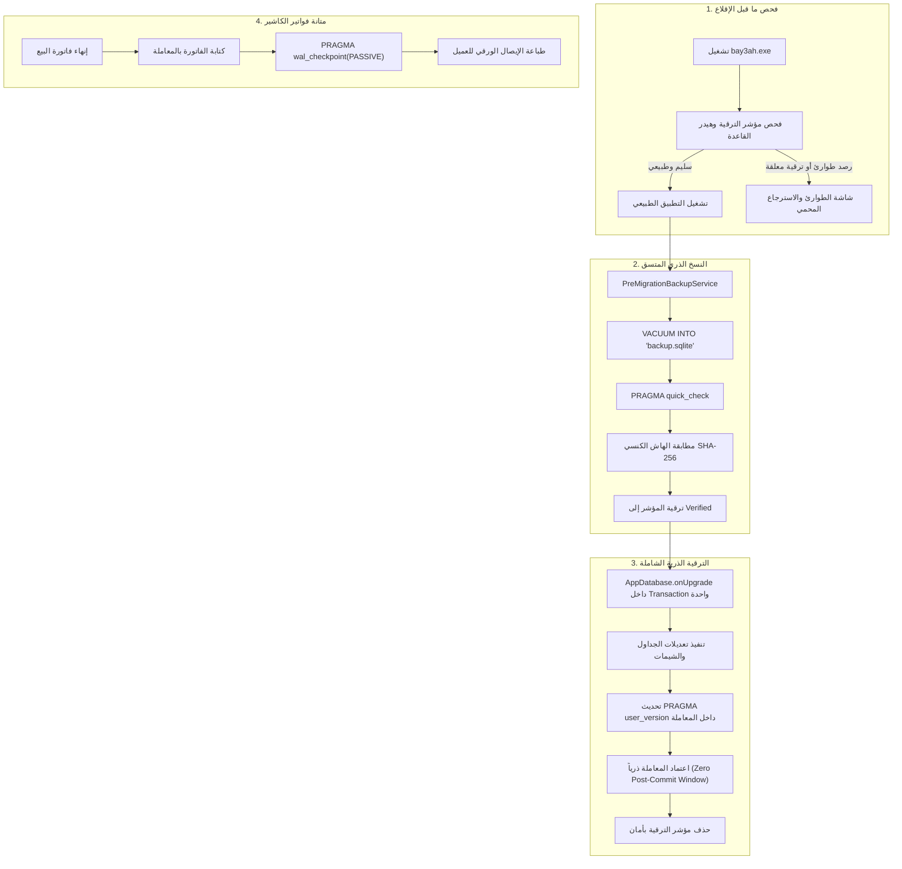

# 09 — منظومة أمان الترقية ومتانة قواعد البيانات (Upgrade Safety & Durability Engine)

---

## 1. لماذا تم بناء منظومة أمان الترقية والمتانة؟ (The Problem Space)

في بيئات تشغيل المتاجر ومحلات التجزئة الفردية (Single-Device / Single-Branch) على أجهزة الكمبيوتر التي تعمل بنظام Windows:
1. **انقطاع التيار الكهربائي الفجائي (Sudden Power Outages)**:
   قد تنقطع الكهرباء أثناء ترقية قاعدة البيانات من إصدار لآخر، أو فور قيام الكاشير بطباعة إيصال البيع للعميل.
2. **الإغلاق القسري للنظام (Forced Shutdown / Task Kill)**:
   قد يقوم المستخدم بإغلاق الجهاز أثناء الترقية، مما يهدد بترك الجداول في حالة جزئية تالفة.
3. **أخطاء أقفال الملفات على Windows (`File Lock / Sharing Violation`)**:
   محاولة نسخ أو استبدال ملفات قاعدة البيانات المفتوحة على نظام Windows تؤدي إلى انهيار التطبيق.

لحل هذه المعضلات جذرياً، تم تصميم وتطبيق **منظومة أمان الترقية والمتانة** وفق أعلى المعايير الهندسية.

---

## 2. الركائز المعمارية الأربع للمنظومة (The 4 Architectural Pillars)

---

## 3. تفاصيل الخدمات الهندسية (Engine Services)

### أ. خدمة مؤشر الترقية (`MigrationMarkerService`)
- مسار الكود: [lib/core/database/migration_marker_service.dart](file:///e:/flutter%20projects/erp%20systems/clothes_erp/lib/core/database/migration_marker_service.dart).
- **الكتابة الذرية**: يكتب المؤشر أولاً في ملف مؤقت `.tmp` مع استدعاء `RandomAccessFile.flush()` لإجبار نظام التشغيل على كتابته على القرص.
- **الاستبدال الذري على Windows**: يستبدل الملف مباشرة عبر `File.rename` دون أي حذف مسبق، معتمداً على نداء النواة `MoveFileEx` بمعامل `MOVEFILE_REPLACE_EXISTING`.
- **التحقق الصارم**: يرفض بصراحة أي قيم مجهولة أو حقول مفقودة بـ `CorruptedMarkerException`، وأي إصدارات مستقبلية بـ `UnsupportedMarkerVersionException`.

### ب. خدمة النسخ الاحتياطي الفيزيائي (`PreMigrationBackupService`)
- مسار الكود: [lib/core/database/pre_migration_backup_service.dart](file:///e:/flutter%20projects/erp%20systems/clothes_erp/lib/core/database/pre_migration_backup_service.dart).
- **اللقطة المتسقة بـ `VACUUM INTO`**: استخدام أمر المحرك المدمج في SQLite 3.53.4 لأخذ نسخة مضغوطة متسقة وقاعدة البيانات مفتوحة، دون التعرض لمشاكل أقفال الملفات على Windows.
- **الهاش الكنسي الصارم (`canonical SHA-256`)**: حساب بصمة مشفرة لكافة صفوف وأعمدة الجداول بصيغة سلكية صارمة:
  `COL:<name>|TYPE:<N|S|I|F|B>|LEN:<len>|VAL:<val>\n` تميز قطعياً بين النصوص الفارغة والقيم المعدومة والبيانات الثنائية.
- **ترقية النسخ المعلقة دون إهدار موارد (Idempotent Promotion)**: في حال انقطاع الطاقة بعد اكتمال ملف النسخة وقبل تحديث المؤشر، يفحص النظام سلامة النسخة الموجودة ويرقيها لـ `verified` دون إعادة نسخ.
- **سياسة الاحتفاظ (Retention Policy)**: الاحتفاظ بآخر 3 إلى 5 نسخ احتياطية مع قاعدة صارمة: "يُمنع حذف النسخة النشطة حالياً، ويُمنع حذف النسخة المعتمدة الوحيدة".

### ج. خدمة وشاشة استرجاع الطوارئ (`EmergencyRecoveryService & Screen`)
- مسار الكود:
  - [lib/core/database/emergency_recovery_service.dart](file:///e:/flutter%20projects/erp%20systems/clothes_erp/lib/core/database/emergency_recovery_service.dart)
  - [lib/core/presentation/screens/emergency_recovery_screen.dart](file:///e:/flutter%20projects/erp%20systems/clothes_erp/lib/core/presentation/screens/emergency_recovery_screen.dart)
- **فلسفة الاسترجاع الآمن**: استبعاد أي كود لاستبدال الملفات تلقائياً (لما فيه من خطورة استبدال قاعدة سليمة بملف قديم). التراجع التلقائي محصور في محرك SQLite الداخلي، بينما الاسترجاع الفيزيائي يُعرض يدوياً للمدير برقم سري في شاشة الطوارئ.
- **التقرير التشخيصي المشفر**: إمكانية تصدير تقرير بضغطة زر لمشاركته مع الدعم الفني عبر واتساب، وهو خالي تماماً من أي بيانات تخص العملاء أو المبيعات.

### د. المعاملة الواحدة وانعدام نافذة الخطر (Zero Post-Commit Window)
- مسار الكود: [lib/core/database/app_database.dart#L1125-L1220](file:///e:/flutter%20projects/erp%20systems/clothes_erp/lib/core/database/app_database.dart#L1125-L1220).
- لف منطق `onUpgrade` بالكامل داخل `m.database.transaction`.
- نقل أمر تحديث الإصدار `PRAGMA user_version = $to;` **داخل** المعاملة.
- **النتيجة الهندسية**: يلتزم رقم الإصدار في نفس اللحظة ونفس الفريم مع تعديلات الجداول. لا توجد أي أجزاء من الثانية تفصل بين اكتمال الترقية وتسجيل رقم الإصدار.

### هـ. متانة فواتير نقطة البيع (POS Checkout Durability Checkpoint)
- مسار الكود: [lib/core/database/app_database.dart#L789-L793](file:///e:/flutter%20projects/erp%20systems/clothes_erp/lib/core/database/app_database.dart#L789-L793) و [lib/features/pos/data/datasources/pos_local_data_source.dart#L250](file:///e:/flutter%20projects/erp%20systems/clothes_erp/lib/features/pos/data/datasources/pos_local_data_source.dart#L250).
- استدعاء `flushWal()` فور انتهاء الفاتورة ينفذ `PRAGMA wal_checkpoint(PASSIVE);`، مما ينقل صفحات الفاتورة المكتوبة من ملف الـ WAL المؤقت إلى ملف قاعدة البيانات الأساسي مباشرة، لحماية الفواتير المطبوعة من الضياع في حال انقطاع الكهرباء الفجائي بعد تسليم الإيصال للعميل.

---

## 4. مصفوفة مقاومة انقطاع التيار الكهربائي في كل خطوة (Power-Cut State Matrix)

| اللحظة الزمنية الدقيقة | الحالة المسجلة | الأثر المباشر عند انقطاع الكهرباء | سلوك النظام التلقائي عند إعادة التشغيل |
|---|---|---|---|
| **1. كتابة النسخة المؤقتة** | لا يوجد Marker مكتمل (`.tmp` فقط) | قاعدة البيانات الأصلية لم تُمس إطلاقاً. يتبقى ملف مؤقت ناقص. | ينظف الإقلاع الملف المؤقت ويبدأ النسخ من جديد. |
| **2. قبل الـ rename للـ Marker** | ملف الباك أب مكتمل، والمؤشر لم يُسجل | قاعدة البيانات الأصلية تعمل بسلام ولم يتم المساس بها. | يكتشف النظام النسخة الاحتياطية ويفحصها أو يعيد أخذها. |
| **3. المؤشر مسجل بـ `pending`** | الباك أب موجود والمؤشر يقول `pending` | قاعدة البيانات لم تبدأ الترقية بعد؛ البيانات الأصلية سليمة 100%. | يفحص الإقلاع النسخة بـ `quick_check` ويرقيها لـ `verified` دون إعادة نسخ. |
| **4. الـ Marker ترقى إلى `verified`** | النسخة معتمدة ومطابقة للهاش الكنسي | قاعدة البيانات الأصلية لم تبدأ خطوات `onUpgrade` بعد. | النظام يعلم أن لديه نسخة موثوقة 100% ويستعد لتنفيذ الترقية بأمان. |
| **5. أثناء تنفيذ `onUpgrade`** | الترقية تجري داخل المعاملة الواحدة | تتوقف المعاملة فوراً، وSQLite يتراجع ذاتياً وتلقائياً بالكامل (ACID Rollback). | عند فتح القاعدة مجدداً، تقرأ SQLite الـ rollback تلقائياً وتعود القاعدة للنسخة القديمة السليمة. |
| **6. لحظة الـ Commit الداخلي** | تم تنفيذ DDL وتحديث `user_version` ذرياً | تم التزام التغييرات بالكامل داخل فريم الـ WAL ذرياً. | تفتح القاعدة بالإصدار الجديد المتزامن تماماً. |
| **7. قبل حذف الـ Marker** | القاعدة ترقت بنجاح لكن ملف المؤشر لم يُحذف | الإصدار في الهيدر هو الإصدار الجديد `user_version == to`. | يفحص النظام تطابق رقم الإصدار ويكتشف اكتمال الترقية، فينظف المؤشر فوراً دون الحاجة لأي استرجاع. |
| **8. إنهاء فاتورة في الكاشير** | تم استدعاء `flushWal()` وطباعة الفاتورة | صفحات الفاتورة انتقلت للقرص الفيزيائي فوراً. | عند عودة الكهرباء وفتح التطبيق، تكون الفاتورة مسجلة بالكامل ولا يضيع أي إيصال مطبوع. |

